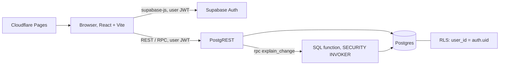

# BillWise architecture

- Frontend: static React app on Cloudflare Pages. Only the public (publishable) key is shipped.
- Backend: Supabase. Auth (email confirmation on), Postgres tables `bills` and `appliances`, row level security on both, and the SQL function `explain_change` that splits a bill change into a units effect and a price effect.
- Security: anon role has no table access; every row is filtered by `auth.uid()`; the function runs as the caller so RLS still applies; constraints block overlapping or invalid periods.
- Tests: Vitest for the analysis logic; `npm run test:db` for RLS and constraints against a real Supabase project.

# Demo script (about 2 minutes)
1. Open the live site, log in with a demo account. Say: "BillWise answers why my bill went up."
2. Show the assumptions card: price per kWh is an average, not the tariff.
3. Show two DEMO bills (Sep 300 kWh / 1500, Oct 360 kWh / 1800).
4. Compare Sep to Oct: daily use 10 to 12 kWh, change 300 = units 300 + price 0. Biggest part: units.
5. Add an appliance (AC, rated watts, hours). What-if with fewer hours: estimated saving at the average rate.
6. Mention: RLS isolation and 12 live DB tests; sign-up needs email confirmation.
